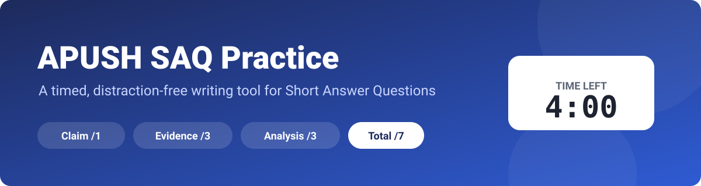
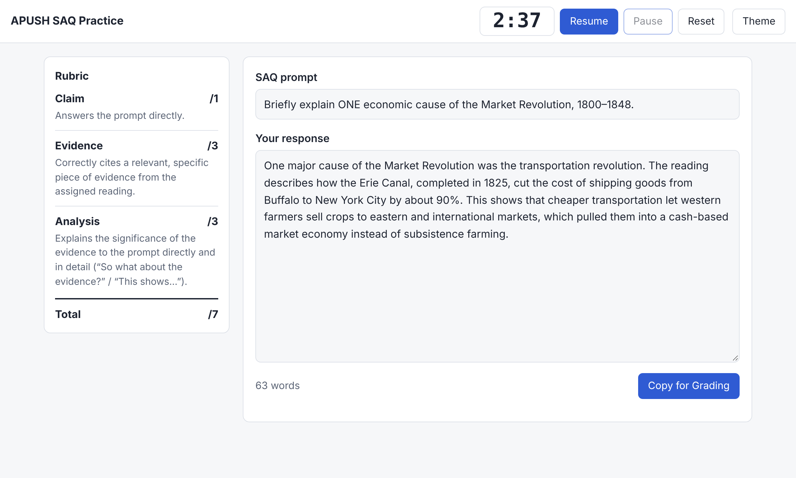
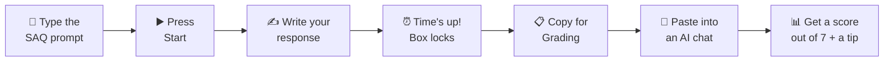
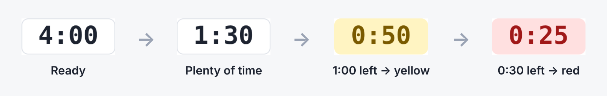
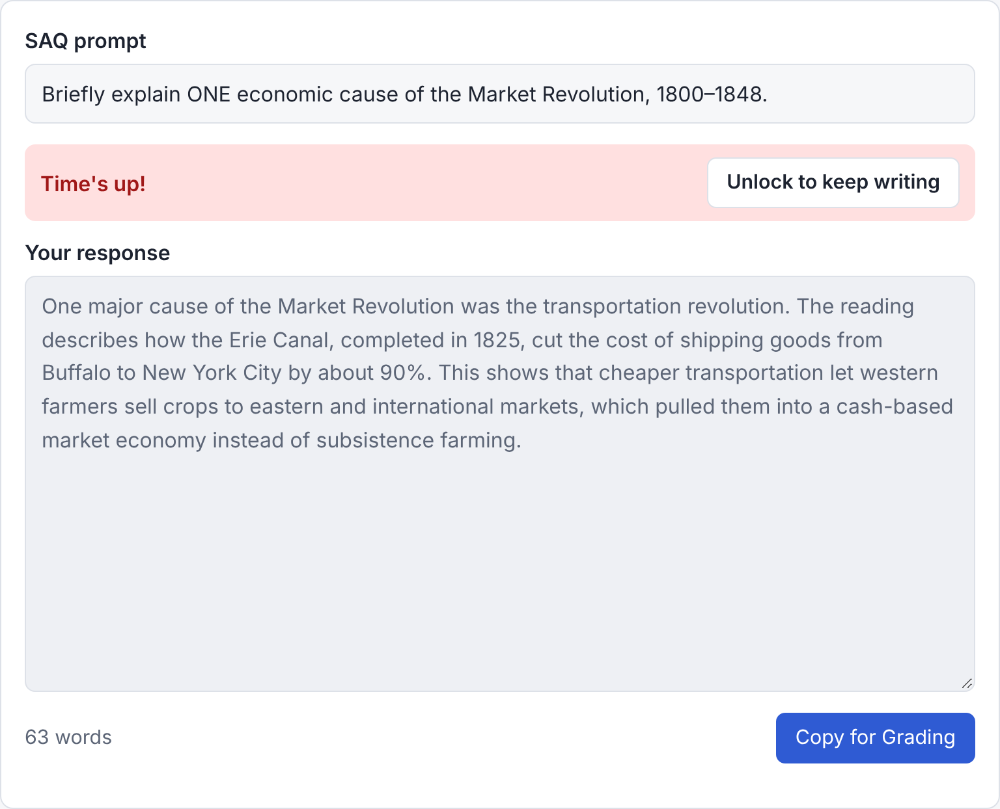
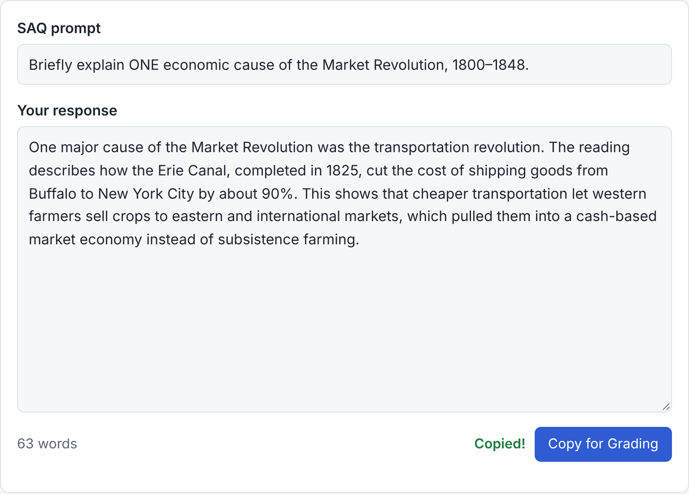
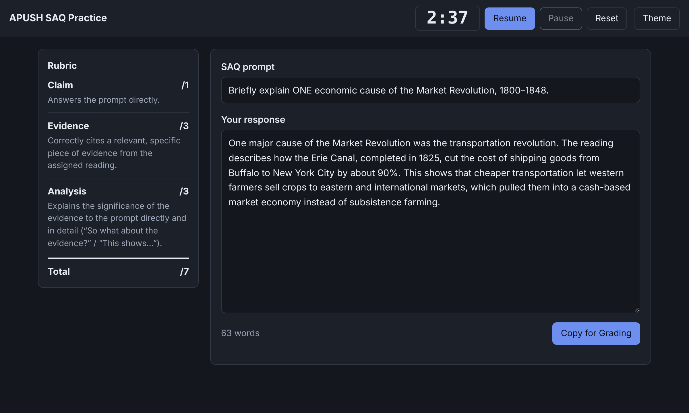
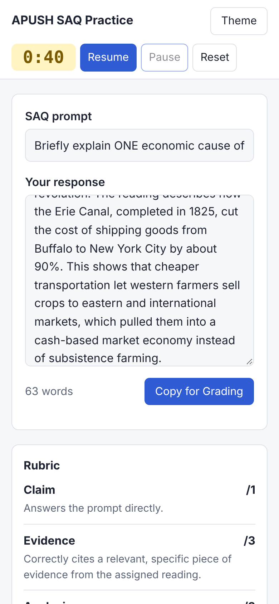

<p align="center">
  
</p>

<p align="center">
  <b>Practice AP U.S. History Short Answer Questions the way you'll take them in class: timed, with no notes, and graded against the rubric.</b>
</p>

<p align="center">
  
  
  
  
</p>

---

## ✨ What it does

| | Feature | Details |
|---|---|---|
| ⏱️ | **4-minute timer** | Start, Pause and Reset buttons. It turns **yellow** at 1:00 and **red** at 0:30. |
| 🔒 | **Locks at 0:00** | Shows "Time's up!" and locks the text box, like pencils-down in class. You can unlock it to finish a thought. |
| 📋 | **Rubric always visible** | Claim /1, Evidence /3 and Analysis /3 stay on screen while you write. |
| 🔢 | **Live word count** | Updates as you type. |
| 🤖 | **Copy for Grading** | One click copies a ready-to-paste message for any AI chat with your prompt, response, word count and time used. |
| 🌗 | **Light / dark mode** | Follows your device's setting, or switch with the Theme button. |
| 🛡️ | **Private** | No accounts, no servers, no tracking. Your writing never leaves your browser unless you paste it somewhere. |

<p align="center">
  
</p>

---

## 🧭 How to use it



1. **Enter the prompt** you're answering at the top.
2. **Press Start** and write. Aim for a clear claim, specific evidence from the reading, and analysis ("This shows…").
3. When the timer hits 0:00 the box **locks**.
4. Click **Copy for Grading**, paste the message into an AI chat, and get your score with feedback.

---

## ⏱️ The timer

The timer changes color as time runs out so you can see how much is left without reading the numbers.

<p align="center">
  
</p>

When it reaches zero, the response box locks:

<p align="center">
  
</p>

---

## 📋 Copy for Grading

Clicking **Copy for Grading** puts this message on your clipboard, with your own prompt and response filled in:

<p align="center">
  
</p>

```text
Please grade my APUSH SAQ response using the rubric below. Be strict like an AP teacher.

CONDITIONS: I wrote this in 4 minutes with no notes, as a timed in-class SAQ. Grade it
as a student response under those conditions (don't penalize minor spelling/grammar,
but do require accuracy and specificity).

RUBRIC:
- Claim (/1): Does the response directly answer the prompt?
- Evidence (/3): Does it cite relevant, specific evidence from the assigned reading?
- Analysis (/3): Does it explain the significance of the evidence and connect it
  directly back to the prompt in detail?

PROMPT: Briefly explain ONE economic cause of the Market Revolution, 1800–1848.

MY RESPONSE (63 words, 2:47 of 4:00 used):
One major cause of the Market Revolution was the transportation revolution. ...

Give a score for each category, a total out of 7, a one-sentence reason for each
score, and one specific tip to improve.
```

---

## 📐 The rubric

| Category | Points | What earns it |
|---|:---:|---|
| **Claim** | /1 | Answers the prompt directly. |
| **Evidence** | /3 | Correctly cites a relevant, specific piece of evidence from the assigned reading. |
| **Analysis** | /3 | Explains the significance of the evidence to the prompt directly and in detail ("So what about the evidence?" / "This shows…"). |
| **Total** | **/7** | |

---

## 🌗 Dark mode and phones

<table>
  <tr>
    <td width="68%"></td>
    <td width="32%"></td>
  </tr>
  <tr>
    <td align="center"><sub>Dark mode</sub></td>
    <td align="center"><sub>On a phone, the rubric moves below the writing area</sub></td>
  </tr>
</table>

---

## 🚀 Getting started

**Option 1: open it directly.** Download `index.html` and double-click it. It opens in your browser and works offline.

**Option 2: put it online with GitHub Pages (free).**

1. In this repository, go to **Settings → Pages**.
2. Under **Build and deployment**, set **Source** to *Deploy from a branch*.
3. Choose the `main` branch and the `/ (root)` folder, then click **Save**.
4. After a minute your tool is live at `https://<your-username>.github.io/<repo-name>/`.

---

## 📁 Files

```text
├── index.html     ← the whole app (HTML, CSS and JavaScript in one file)
├── README.md
└── *.png, banner.svg  ← screenshots and banner used in this README
```

## 🔒 Privacy

Everything runs in your browser. There is no login, no analytics and no server. The only thing the page remembers is your light/dark choice, stored in your own browser.
